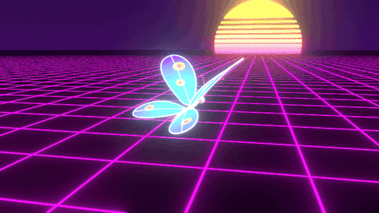

# blender-scripts

Python scripts that build animated 3D scenes in Blender through its `bpy`
API, and a shell script that renders and exports them to images, videos and
3D formats, about forty in all. Each scene is a self-contained project in
`scripts/` with AI-generated code.

## Requirements

- Blender, with `blender` on the `PATH` (scenes use the EEVEE renderer)
- FFmpeg, with `ffmpeg` on the `PATH`, for the `gif` output

Blender brings its own Python, so nothing else needs to be installed.

## Usage

```sh
./project.sh <project> <format>        # build one format
./project.sh <project> all             # build every format
./project.sh all <format>              # build every project
./project.sh <project> <format> clean  # remove one output
./project.sh <project> clean           # remove all outputs of a project
./project.sh clean                     # remove build/ and blend/
```

For example:

```sh
./project.sh cyberpunk-butterfly00 mp4
```

Outputs go to `build/<project>.<format>`, and `blend` outputs to
`blend/<project>.blend`. Existing outputs are skipped, so clean them to
rebuild. Run `./project.sh` from the repository root. Without arguments,
it prints the usage with every format and the first ten projects.

### Formats

`abc avi avif bmp cin dpx dv exr fbx flv gif glb gltf hdr jp2 jpg mkv mov
mp4 mpg obj ply png png100 rgb stl tga tif usd usda usdc usdz vob webm
webp blend`

- **Still images** (`avif bmp cin dpx exr hdr jp2 jpg png png100 rgb tga
  tif webp`) render one 1920×1080 frame: `png` the middle frame of the
  animation, the others frame 100 (`png100` is written as
  `build/<project>100.png`).
- **Videos** (`avi dv flv mkv mov mp4 mpg ogv vob webm`) render the whole
  animation at 1920×1080, except `dv`, which is PAL DV at 720×576 and 25
  fps. `gif` renders it at 640×360 and assembles the frames with FFmpeg,
  using a palette made from the animation itself.
- **3D scenes** (`abc fbx glb gltf obj ply stl usd usda usdc usdz`) export
  the scene for other 3D programs. `abc`, `fbx`, `glb`, `gltf` and the USD
  formats keep the animation, and `glb` and `gltf` bake it and include the
  camera. `obj`, `ply` and `stl` hold only the geometry of the first
  frame. `gltf` writes `build/<project>.bin` next to it and `obj` writes
  `build/<project>.mtl`.
- **`blend`** saves the generated scene, to open and edit it in Blender.

## How it works

```
project.sh ──> blender -b -P scripts/export<format>.py -- <project>
                                    │
                                    ▼
                             scripts/common.py
                                    │ load_project()
                                    ▼
           scripts/<project>/<name>.py: <name>() builds the scene
                                    │
                                    ▼
                bpy.ops.render.render() or a bpy.ops exporter
```

- `project.sh` checks the arguments and runs Blender in the background
  (`-b`) with `scripts/export<format>.py` (or `scripts/saveblend.py`),
  passing the project after `--`. `--python-exit-code 1` makes a failing
  script fail the build.
- `scripts/common.py` imports the project, calls its function to build the
  scene in Blender's empty startup file and returns the output path.
- Each `scripts/export<format>.py` sets the render settings or calls the
  exporter for one format.

## Projects

A project is a folder `scripts/<theme>-<name>/` holding `<name>.py` with a
function `<name>()`, which builds the whole scene (objects, materials,
lights, camera, world and animation) from code:

```
scripts/cyberpunk-butterfly00/
└── butterfly00.py   # butterfly00() clears the scene and builds it
```

The last part of the folder name is the module and function name, so it
must be a valid Python name. A project needs nothing outside its folder.

`cyberpunk-butterfly00` is a ten second, 30 fps flight of a neon butterfly
over a synthwave grid towards a striped sun. It is the 3D version of the
drawing in [inkscape-scripts](https://github.com/aljazmc/inkscape-scripts),
whose pixel coordinates it keeps: the wings are meshes that flap and bend,
the glow comes from emission shaders and bloom, and the camera follows a
smoothed flight path.

Themes such as `cyberpunk`, `steampunk`, `nature` and historical eras are
work in progress and kept out of the repository by `.gitignore` until they
are ready.

## Tests

```sh
bash tests/test_project.sh             # project.sh
python3 -m unittest discover tests     # the Python scripts
```

The tests need only bash and Python's standard library, and none of them
runs the application or writes outputs. `tests/test_project.sh` checks
that `project.sh` rejects bad arguments with its usage and exit code 1.
`tests/test_common.py` checks that `load_project()` stops with a message
when the project is missing or unknown; it runs on plain Python, without
Blender.

To lint the code with [ShellCheck](https://www.shellcheck.net/) and
[Ruff](https://docs.astral.sh/ruff/):

```sh
shellcheck project.sh tests/*.sh
ruff check .
```

## Gallery

`cyberpunk-butterfly00`, exported with `./project.sh cyberpunk-butterfly00 gif`
and reduced to 480×270 at 15 fps with FFmpeg to keep the file small:



## License

The scripts are licensed under the MIT license, see [LICENSE](LICENSE).
The files in `gallery/` were made with them and are under the same
license.

The scripts drive software that is not part of this repository and has
licenses of its own:

- [Blender](https://www.blender.org/about/license/) is free software
  under the GNU General Public License, version 2 or later; the Blender
  binaries as a whole are distributed under version 3 or later. These
  scripts use the `bpy` API and run inside Blender; Blender's license FAQ
  treats such scripts as covered by the GPL when they are distributed
  together with Blender, and the MIT license is compatible with the GPL.
  Whatever you render or export with Blender is yours, and the GPL does
  not apply to it.
- [FFmpeg](https://ffmpeg.org/legal.html) is licensed under the GNU LGPL,
  version 2.1 or later, or the GNU GPL, version 2 or later, depending on
  how it was built.
